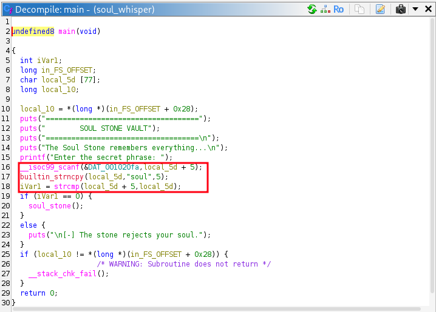

# Soul's Whisper

**Category Reverse Engineering**

## Challenge Description

The Soul Stone has locked away a secret, but the stone only recognizes the right soul. Analyze the given executable, uncover how it validates the input, and retrieve the hidden flag.

**File Attachments :**
* [soul_whisper_bin](soul_whisper_bin)

## Exploit

Just need to open the file with Ghidra, in the main function we can see a comparaison between the word entered and soul, if it was true then it launch the success function that prints the flag. 

Just needed to launch the function after that and retrieve the flag :

Flag: `OWASP{th3_s0ul_st0n3_wh1sp3r}`
